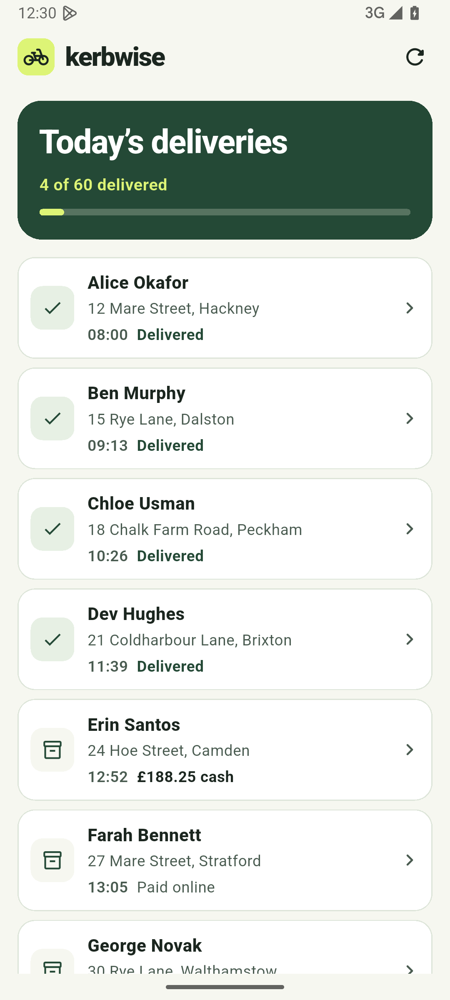
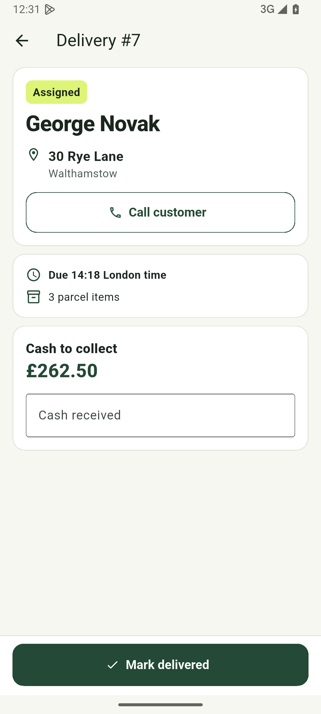
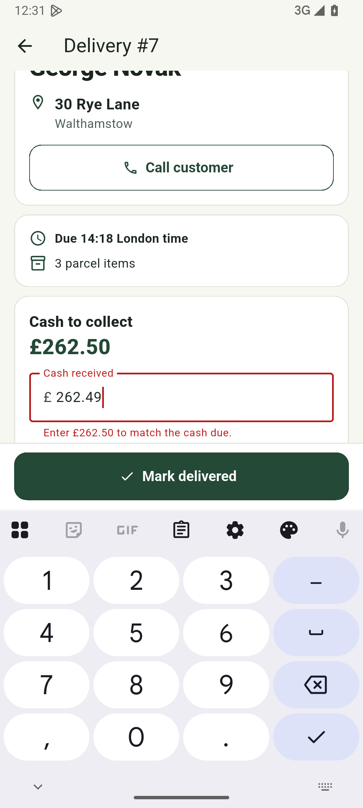

# Kerbwise Courier

An Android courier app built with **Flutter**. It uses the calm mock API for Step 1.

For development setup and pull request guidance, see [Contributing](CONTRIBUTION.md).

## Screenshots

| Today’s deliveries | Delivery details | Cash validation |
| :---: | :---: | :---: |
| [](screenshot/home.png) | [](screenshot/delivery-details.png) | [](screenshot/cash-validation.png) |

## Clone the repository

```sh
git clone https://github.com/dotsehyde/kerbwise-acloe.git
cd kerbwise-acloe
```

## Set up and start the API

Install Node.js 18+ and Flutter 3.44+ with the Android SDK, Android platform tools (`adb`), and JDK 17. From the repository directory, check your toolchain, install the Flutter dependencies, and start the calm mock API.

```sh
flutter doctor
flutter pub get
node courier-server.js
```

Leave this terminal running. The API listens on port 4000. Restarting it resets the deliveries.

## Run on Android

Open a second terminal in the `kerbwise-acloe` directory. Start an Android Studio emulator or connect a phone over USB. For a phone, enable USB debugging and accept the debugging prompt. Find your device ID with `flutter devices`.

**Android Studio emulator**

```sh
flutter run -d emulator-5554
```

Use the ID shown by `flutter devices` if yours differs. The app defaults to `http://10.0.2.2:4000`, which reaches the host from the emulator.

**Android phone over USB**

```sh
adb -s PHONE_ID reverse tcp:4000 tcp:4000
flutter run -d PHONE_ID --dart-define=COURIER_API_URL=http://127.0.0.1:4000
```

Replace `PHONE_ID` with the connected phone’s ID. Keep the USB connection active. The debug build allows HTTP for the local mock.

## Check the courier flow

- The list should show 60 deliveries. Scroll to the bottom to find Oscar Reid, delivery #60.
- Open George Novak, delivery #7, to see the address and cash due. **Call customer** opens the Android dialer with the number filled in. Enter `262.49` and tap **Mark delivered** to see the cash validation, then enter `262.50` to complete it.
- Open Farah Bennett, delivery #6. **Mark delivered** records the handover without a cash entry. Return to the list to see the updated status and count.
- Stop the API and tap **Refresh deliveries** to check the connection error. Restart it and tap **Try again**.

The list uses the API’s run for today and displays due times in London time. Completion needs a connection in Step 1. If a request loses its response, tapping **Mark delivered** again in the same app session reuses the idempotency key for the same amount. Customer details are held in memory during use.

## Project structure

The Flutter app follows Model–View–Controller (MVC).

```text
lib/
├── main.dart                            # App entry point and API configuration
├── models/
│   └── delivery.dart                    # Delivery data and JSON parsing
├── pages/
│   ├── home_screen.dart                 # Today’s list and delivery progress
│   └── delivery_detail_screen.dart      # Address, customer call, and handover
├── controllers/
│   ├── home_controller.dart             # List loading and delivery status updates
│   └── delivery_detail_controller.dart  # Detail loading, cash validation, and completion
├── services/
│   ├── courier_api.dart                 # HTTP requests, pagination, and idempotency
│   └── customer_dialer.dart             # Opens the Android dialer
└── core/
    ├── theme/                           # Colors and Material theme
    ├── shared/                          # Reusable screen messages
    └── utils/                           # GBP and London time formatting
```

The pages rebuild when their controllers publish state changes. When the API confirms a handover, the detail page reports the updated delivery to the home controller, which updates the row and progress count.

The Android host project lives in `android/`. The calm mock runs from `courier-server.js`, and its endpoints and response formats are documented in the [Courier API notes](docs/courier-api-notes.md).

## Run the checks

```sh
flutter analyze
flutter test
```

The [widget tests](test/courier_app_test.dart) cover pagination, cash and prepaid completion, duplicate taps, and retry behavior. They use a mock HTTP client, so the server and emulator can stay off for these checks.
